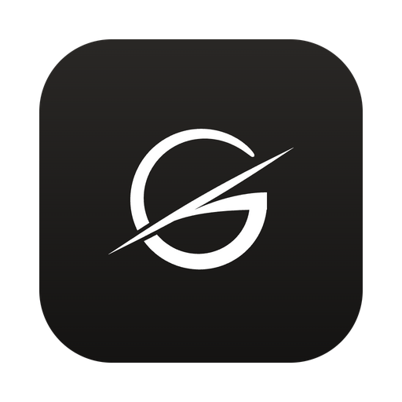
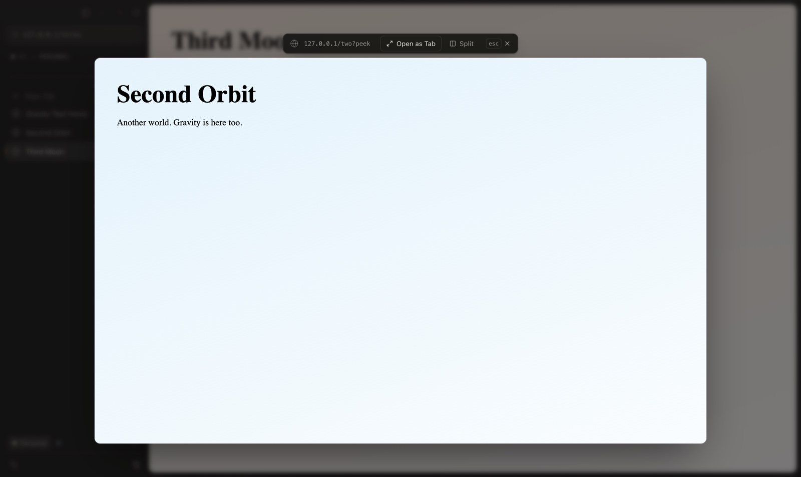

<p align="center">
  
</p>

<h1 align="center">Gravity</h1>

<p align="center">
  A quiet, keyboard-first browser for macOS.<br />
  Vertical tabs, spaces, one command bar, and a little physics.
</p>

<p align="center">
  
</p>

---

Most browsers compete on features. Gravity competes on feel. It is a small, opinionated browser for people who keep a lot of tabs open and want the interface to recede: neutral colours, hairline rules, monospaced metadata, one muted accent. The motion is physical rather than decorative. Pages have a little weight, cards settle where you drop them, and things you dismiss fall away instead of fading.

It is built on Chromium (via Electron), so sites work the way they do in Chrome.

> **Status:** early (0.1). Daily-drivable for browsing, but expect rough edges. Builds are unsigned for now.

## Features

| | |
| --- | --- |
| **A real black hole** | Home is a Schwarzschild black hole ray traced on the GPU: gravitational lensing, the photon ring, a Shakura–Sunyaev accretion disk with Doppler beaming and gravitational redshift. Drag to orbit, scroll to fall closer. The disk grows denser as you open tabs, and flares when something falls in. In dark mode it becomes the window itself, behind a glass sidebar. Settings → Background swaps it for photographs of mountains (misty valleys, Ama Dablam, Everest, Fitz Roy, the Khumbu, with the Milky Way for the night if you like), desert dunes or a forest under drifting fog, or Hokusai's great wave; Live, Still or Off. These have a day and a night: Time of day follows sunrise and sunset where you are, or stays on Day or Night. |
| **Command Bar** `⌘T` `⌘L` | One field for addresses, search, open tabs across spaces, history (ranked by frecency), favorites, archived tabs, commands, and inline arithmetic. `↩` opens, `⌘↩` opens in the background, `⇧↩` peeks, `⌥↩` splits. Closing it without choosing anything leaves no empty tab behind. |
| **Favorites** `⇧⌘D` | The pages you keep, under the search field on Home and at the top of the sidebar. Each has a small paper label for its icon and a digit: press `1`–`9` on Home to open one. Add the page you're on with the star or `⇧⌘D`, or pick one from Home (an address, an open tab or something from history). Drag to reorder, or `⌥` + arrows; throw one up and away, or press `⌫`, to remove it. |
| **Overview** `⇧⌘\` | The page shrinks into its card and the rest of the space settles into a grid. Type to filter, use the arrow keys, or flick a card upward to close it. |
| **Peek** `⇧`-click | Opens a link in a card above the current page. Keep it as a tab, put it in a split, or press `esc` and let it drop. Moving a peek into a tab or a split does not reload it. |
| **Split view** `⌥⌘\` | Drag a tab from the sidebar onto either half of the page. The divider snaps to halves and thirds. |
| **Spaces** `⌃1–9` | Separate sets of tabs, each with its own muted swatch. Swipe sideways on the sidebar to move between them. Private spaces (`⇧⌘N`) keep nothing on disk. |
| **Quiet by default** | Idle tabs go to sleep after 15 minutes. Unpinned tabs you haven't opened in 12 hours move to a searchable Archive. Both are adjustable. |
| **Shield** | Ad and tracker blocking via Ghostery's open-source engine, with a per-page count. |
| **Tunnel** | Hides your IP address by sending pages through Tor, for private spaces only or for every tab. No account, no server and nothing else to install: Gravity ships tor and runs it locally. DNS goes through Tor as well, WebRTC can't reveal your address, and if tor stops, pages fail to load instead of going out directly. Where Tor is blocked, it moves on to a Snowflake bridge and then a meek bridge by itself, remembers what worked on each network, and reconnects when your Mac changes networks (or set Bridge to Always so your network can't see you use Tor). Pages load slower, and some sites ask for a CAPTCHA. Settings → Privacy → Tunnel. |
| **Passwords** | A password manager built in. Settings → Passwords (behind Touch ID) lists them with a title, site, username, password and notes; search, add, edit, copy (a copied password leaves the clipboard after a minute), and a generator for strong ones. Weak and reused passwords are marked. On a saved site, the sign-in form fills itself in; with several accounts, focusing the field offers a choice. Sign in somewhere new and Gravity offers to save it, or to update a changed password (never in private spaces). Everything is encrypted with a key in your macOS keychain and never leaves the Mac. |
| **Two-finger swipe** | Back and forward from the trackpad, with a small indicator that fills as you go. |
| **Pinch** | Spread two fingers to zoom a page, pinch them back to return to actual size, like Safari. Pinch in on a page at actual size and it falls into the Overview. `⌘+` `⌘−` `⌘0` work on the same zoom. |
| **The rest** | Focus mode (`⇧⌘F`), hover-to-reveal sidebar (`⌘S`), find in page, zoom, downloads, permission prompts, session restore, default-browser support, light and dark themes. |

<p align="center">
  
  
</p>
<p align="center">
  
  
</p>

## Keyboard

| Shortcut | Action | Shortcut | Action |
| --- | --- | --- | --- |
| `⌘T` | Command Bar / new tab | `⇧⌘\` | Overview |
| `⌘L` | Edit address | `⌥⌘\` | Split view |
| `⌘W` | Close tab | `⇧⌘F` | Focus mode |
| `⇧⌘H` | Home (tabs stay open) | `⇧⌘D` | Add to Favorites |
| `⇧⌘T` | Reopen closed tab | `⌘S` | Toggle sidebar |
| `⌃Tab` | Next tab | `⌃1–9` | Switch space |
| `⌘1–9` | Jump to tab | `⇧⌘N` | Private space |
| `⌘D` | Pin tab | `⇧⌘C` | Copy URL |
| `⌘[` `⌘]` | Back / forward | `⌥⌘L` | Downloads |
| `⌘F` | Find on page | `⌘/` | All shortcuts |

Holding `⌘` for a moment shows the full list.

## Install

There are no signed releases yet. To build your own:

```bash
git clone https://github.com/OWNER/gravity.git
cd gravity
npm install
npm run dist
```

The `.dmg` and `.zip` files (arm64 and x64) end up in `dist/`. Because the build is unsigned, the first launch needs a right-click → **Open**.

## Develop

Requires macOS and Node 22 or newer.

```bash
npm install
npm run tor          # downloads tor and Snowflake for the Tunnel (pinned hashes; falls back to a mirror if torproject.org is blocked)
npm run dev          # app with hot reload
npm run typecheck
npm test             # unit tests (Vitest)
npm run test:e2e     # end-to-end tests against the built app (Playwright)
```

[`docs/ARCHITECTURE.md`](docs/ARCHITECTURE.md) explains how the pieces fit together, and [`CONTRIBUTING.md`](CONTRIBUTING.md) covers conventions, including the design rules. The roadmap lives in [`docs/IDEAS.md`](docs/IDEAS.md).

## Privacy

Gravity has no account, no telemetry and no server of its own. Your history, sessions and settings are JSON files in `~/Library/Application Support/Gravity`. Network requests Gravity makes on its own behalf:

- **Search suggestions**: what you type goes to your chosen search engine. Turn this off in Settings.
- **Shield filter lists**: downloaded from Ghostery's CDN and cached locally.
- **Favicon colours**: favicons of the sites you visit are fetched again to sample a colour.

With the Tunnel on, all of these go through Tor too.

With Time of day on Auto and a photo or the wave as the background, Gravity asks macOS for your location to work out sunrise and sunset (macOS asks you first). It keeps it in memory only, rounded to about 10 km, and never saves or sends it; the sun's position is computed on your Mac. If you say no, your time zone stands in.

## Built with

[Electron](https://www.electronjs.org) · [Tor](https://www.torproject.org) · [React](https://react.dev) · [Motion](https://motion.dev) · [Tailwind CSS](https://tailwindcss.com) · [Zustand](https://zustand.docs.pmnd.rs) · [Lucide](https://lucide.dev) · [@ghostery/adblocker](https://github.com/ghostery/adblocker) (MPL-2.0)

Some animated primitives are adapted from [Magic UI](https://magicui.design) (MIT): border beam, number ticker, blur fade, magic card, animated list and circular progress. The elastic slider in Settings comes from [React Bits](https://reactbits.dev) (MIT + Commons Clause). The sources live in `src/renderer/src/components`, and the [`.mcp.json`](.mcp.json) in this repo lets AI coding tools browse both registries.

The great wave background is Katsushika Hokusai's *Under the Wave off Kanagawa* (c. 1831), public domain, from [the Metropolitan Museum of Art's scan](https://commons.wikimedia.org/wiki/File:Tsunami_by_hokusai_19th_century.jpg) on Wikimedia Commons.

The other backgrounds are photographs from [Unsplash](https://unsplash.com), used under the [Unsplash License](https://unsplash.com/license) and resized: mountain ridges above misty valleys by [Alessio Soggetti](https://unsplash.com/photos/zxcBR3zNc7I), Ama Dablam at dusk by [Eugene Ga](https://unsplash.com/photos/infssQ2tjeM), Everest at sunset by [Weichao Deng](https://unsplash.com/photos/eyn0LjpNWV4), Fitz Roy at sunrise by [Andrew Svk](https://unsplash.com/photos/150fZ07GQqs), Ama Dablam among clouds by [Rohit Tandon](https://unsplash.com/photos/9wg5jCEPBsw), the Milky Way over Key Summit by [Phil Botha](https://unsplash.com/photos/a0TJ3hy-UD8), dunes at Merzouga by [Mark Kuiper](https://unsplash.com/photos/2BMSj-xN008), the Arabian Desert at night by [Mike Iukhtenko](https://unsplash.com/photos/a2kD4b0KK4s), and fog over a conifer forest by [Vadim Sherbakov](https://unsplash.com/photos/NQSWvyVRIJk).

## License

[MIT](LICENSE), except the background photographs in `src/renderer/src/features/scenes/photos`, which stay under the Unsplash License. The Tunnel bundles the Tor Project's builds of [tor](https://gitlab.torproject.org/tpo/core/tor) and [lyrebird](https://gitlab.torproject.org/tpo/anti-censorship/pluggable-transports/lyrebird) as separate programs. The tor build is GPL-3.0, and its licence, with lyrebird's, libevent's and OpenSSL's, ships inside the app (`Contents/Resources/tor/licenses`).
