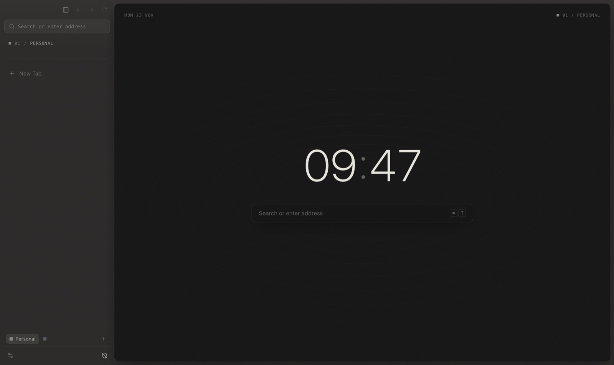
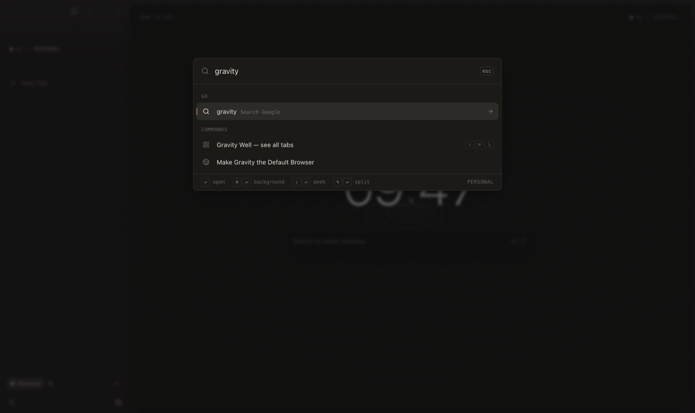
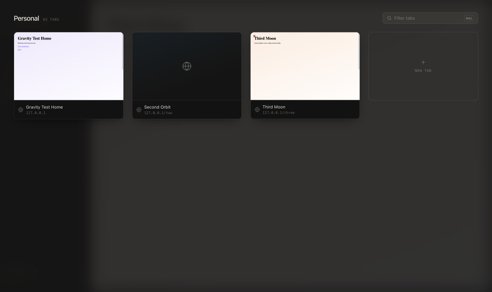
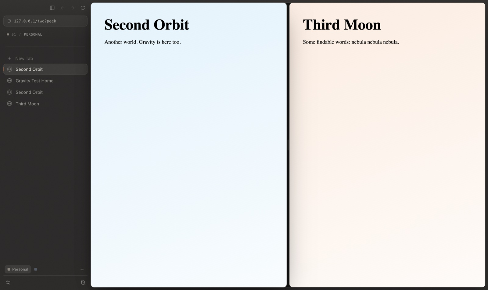

<p align="center">
  
</p>

<h1 align="center">Gravity</h1>

<p align="center">
  A quiet, keyboard-first browser for macOS.<br />
  Vertical tabs, spaces, one command bar, and a little physics.
</p>

<p align="center">
  
</p>

---

Most browsers compete on features. Gravity competes on feel. It is a small, opinionated browser for people who keep a lot of tabs open and want the interface to recede: neutral colours, hairline rules, monospaced metadata, one muted accent. The motion is physical rather than decorative. Pages have a little weight, cards settle where you drop them, and things you dismiss fall away instead of fading.

It is built on Chromium (via Electron), so sites work the way they do in Chrome.

> **Status:** early (0.1). Daily-drivable for browsing, but expect rough edges. Builds are unsigned for now.

## Features

| | |
| --- | --- |
| **Command Bar** `⌘T` `⌘L` | One field for addresses, search, open tabs across spaces, history (ranked by frecency), favorites, archived tabs, commands, and inline arithmetic. `↩` opens, `⌘↩` opens in the background, `⇧↩` peeks, `⌥↩` splits. Closing it without choosing anything leaves no empty tab behind. |
| **Overview** `⇧⌘\` | The page shrinks into its card and the rest of the space settles into a grid. Type to filter, use the arrow keys, or flick a card upward to close it. |
| **Peek** `⇧`-click | Opens a link in a card above the current page. Keep it as a tab, put it in a split, or press `esc` and let it drop. Moving a peek into a tab or a split does not reload it. |
| **Split view** `⌥⌘\` | Drag a tab from the sidebar onto either half of the page. The divider snaps to halves and thirds. |
| **Spaces** `⌃1–9` | Separate sets of tabs, each with its own muted swatch. Swipe sideways on the sidebar to move between them. Private spaces (`⇧⌘N`) keep nothing on disk. |
| **Quiet by default** | Idle tabs go to sleep after 15 minutes. Unpinned tabs you haven't opened in 12 hours move to a searchable Archive. Both are adjustable. |
| **Shield** | Ad and tracker blocking via Ghostery's open-source engine, with a per-page count. |
| **Two-finger swipe** | Back and forward from the trackpad, with a small indicator that fills as you go. |
| **The rest** | Focus mode (`⇧⌘F`), hover-to-reveal sidebar (`⌘S`), find in page, zoom, downloads, permission prompts, session restore, default-browser support, light and dark themes. |

<p align="center">
  
  
</p>
<p align="center">
  
  
</p>

## Keyboard

| Shortcut | Action | Shortcut | Action |
| --- | --- | --- | --- |
| `⌘T` | Command Bar / new tab | `⇧⌘\` | Overview |
| `⌘L` | Edit address | `⌥⌘\` | Split view |
| `⌘W` | Close tab | `⇧⌘F` | Focus mode |
| `⇧⌘T` | Reopen closed tab | `⌘S` | Toggle sidebar |
| `⌃Tab` | Next tab | `⌃1–9` | Switch space |
| `⌘1–9` | Jump to tab | `⇧⌘N` | Private space |
| `⌘D` | Pin tab | `⇧⌘C` | Copy URL |
| `⌘[` `⌘]` | Back / forward | `⌥⌘L` | Downloads |
| `⌘F` | Find on page | `⌘/` | All shortcuts |

Holding `⌘` for a moment shows the full list.

## Install

There are no signed releases yet. To build your own:

```bash
git clone https://github.com/OWNER/gravity.git
cd gravity
npm install
npm run dist
```

The `.dmg` and `.zip` files (arm64 and x64) end up in `dist/`. Because the build is unsigned, the first launch needs a right-click → **Open**.

## Develop

Requires macOS and Node 22 or newer.

```bash
npm install
npm run dev          # app with hot reload
npm run typecheck
npm test             # unit tests (Vitest)
npm run test:e2e     # end-to-end tests against the built app (Playwright)
```

[`docs/ARCHITECTURE.md`](docs/ARCHITECTURE.md) explains how the pieces fit together, and [`CONTRIBUTING.md`](CONTRIBUTING.md) covers conventions, including the design rules. The roadmap lives in [`docs/IDEAS.md`](docs/IDEAS.md).

## Privacy

Gravity has no account, no telemetry and no server of its own. Your history, sessions and settings are JSON files in `~/Library/Application Support/Gravity`. Network requests Gravity makes on its own behalf:

- **Search suggestions**: what you type goes to your chosen search engine. Turn this off in Settings.
- **Shield filter lists**: downloaded from Ghostery's CDN and cached locally.
- **Favicon colours**: favicons of the sites you visit are fetched again to sample a colour.

## Built with

[Electron](https://www.electronjs.org) · [React](https://react.dev) · [Motion](https://motion.dev) · [Tailwind CSS](https://tailwindcss.com) · [Zustand](https://zustand.docs.pmnd.rs) · [Lucide](https://lucide.dev) · [@ghostery/adblocker](https://github.com/ghostery/adblocker) (MPL-2.0)

Some animated primitives are adapted from [Magic UI](https://magicui.design) (MIT): border beam, number ticker, blur fade, magic card, animated list and circular progress. The elastic slider in Settings comes from [React Bits](https://reactbits.dev) (MIT + Commons Clause). The sources live in `src/renderer/src/components`, and the [`.mcp.json`](.mcp.json) in this repo lets AI coding tools browse both registries.

## License

[MIT](LICENSE)
